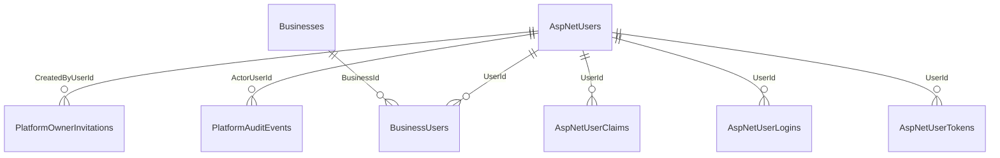
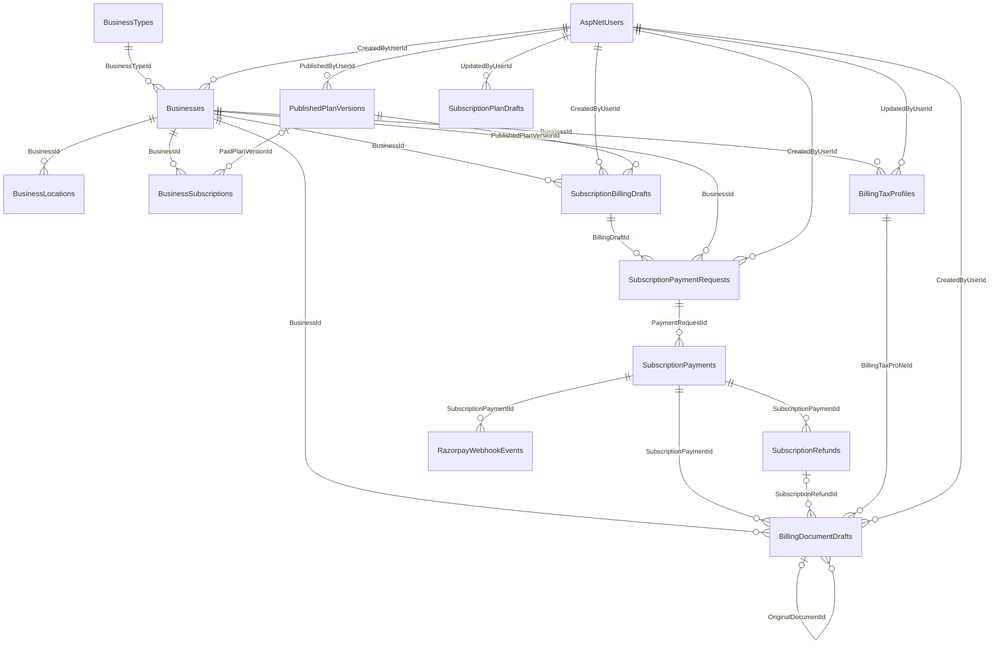
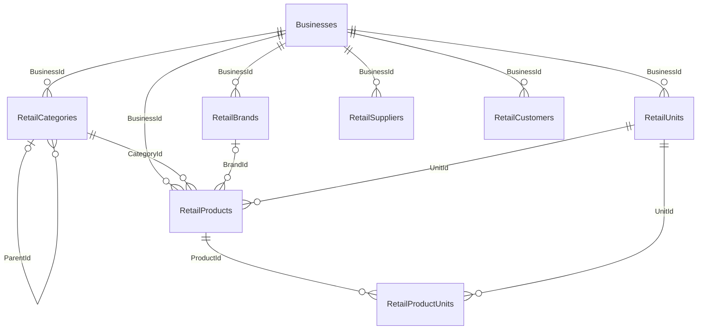
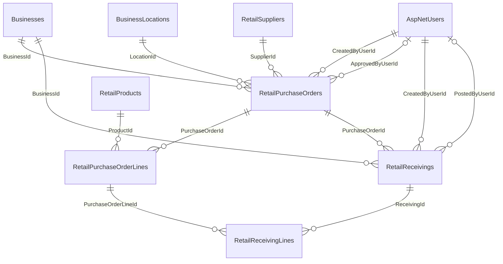
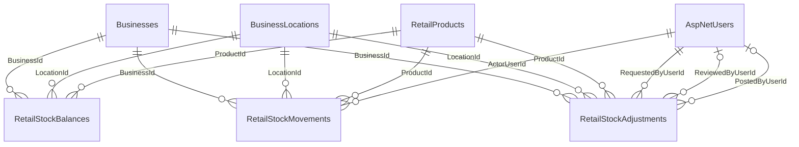
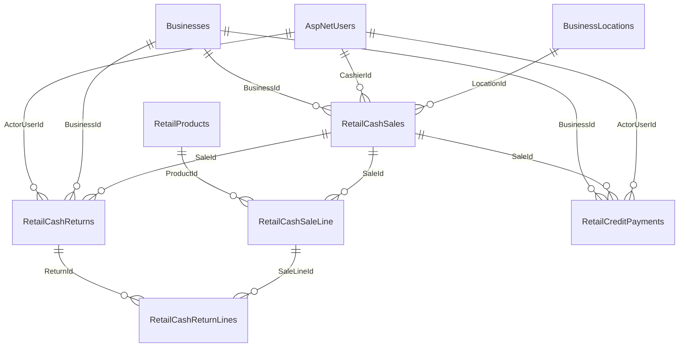

# SQL Server database design

Source: [EF Core snapshot at 3284931](https://github.com/dharmendra1031/business_saas/blob/32849313b05fe2af6468563df08f66aa549d4c17/backend/BusinessSaas.Api/Data/Migrations/AppDbContextModelSnapshot.cs).

Tables: 42; columns: 407; foreign keys: 82; secondary index definitions: 108.

Source model only; live SQL Server verification pending. PK columns are non-null. Nullability derived from CLR types and required configuration.

## Master ERD

```mermaid
erDiagram
AspNetUsers ||--o{ PlatformOwnerInvitations : "CreatedByUserId"
AspNetUsers ||--o{ PlatformAuditEvents : "ActorUserId"
BusinessTypes ||--o{ Businesses : "BusinessTypeId"
AspNetUsers ||--o{ Businesses : "CreatedByUserId"
Businesses ||--o{ BusinessLocations : "BusinessId"
Businesses ||--o{ BusinessSubscriptions : "BusinessId"
PublishedPlanVersions |o--o{ BusinessSubscriptions : "PaidPlanVersionId"
Businesses ||--o{ BusinessUsers : "BusinessId"
AspNetUsers ||--o{ BusinessUsers : "UserId"
AspNetUsers ||--o{ PublishedPlanVersions : "PublishedByUserId"
Businesses ||--o{ BillingTaxProfiles : "BusinessId"
AspNetUsers ||--o{ BillingTaxProfiles : "UpdatedByUserId"
Businesses ||--o{ BillingDocumentDrafts : "BusinessId"
SubscriptionPayments ||--o{ BillingDocumentDrafts : "SubscriptionPaymentId"
SubscriptionRefunds |o--o{ BillingDocumentDrafts : "SubscriptionRefundId"
BillingDocumentDrafts |o--o{ BillingDocumentDrafts : "OriginalDocumentId"
BillingTaxProfiles ||--o{ BillingDocumentDrafts : "BillingTaxProfileId"
AspNetUsers ||--o{ BillingDocumentDrafts : "CreatedByUserId"
Businesses ||--o{ SubscriptionBillingDrafts : "BusinessId"
AspNetUsers ||--o{ SubscriptionBillingDrafts : "CreatedByUserId"
PublishedPlanVersions ||--o{ SubscriptionBillingDrafts : "PublishedPlanVersionId"
SubscriptionBillingDrafts ||--o{ SubscriptionPaymentRequests : "BillingDraftId"
Businesses ||--o{ SubscriptionPaymentRequests : "BusinessId"
AspNetUsers ||--o{ SubscriptionPaymentRequests : "CreatedByUserId"
SubscriptionPaymentRequests ||--o{ SubscriptionPayments : "PaymentRequestId"
SubscriptionPayments ||--o{ SubscriptionRefunds : "SubscriptionPaymentId"
SubscriptionPayments ||--o{ RazorpayWebhookEvents : "SubscriptionPaymentId"
AspNetUsers ||--o{ SubscriptionPlanDrafts : "UpdatedByUserId"
Businesses ||--o{ RetailCategories : "BusinessId"
RetailCategories |o--o{ RetailCategories : "ParentId"
Businesses ||--o{ RetailBrands : "BusinessId"
Businesses ||--o{ RetailUnits : "BusinessId"
Businesses ||--o{ RetailProducts : "BusinessId"
RetailCategories ||--o{ RetailProducts : "CategoryId"
RetailBrands |o--o{ RetailProducts : "BrandId"
RetailUnits ||--o{ RetailProducts : "UnitId"
Businesses ||--o{ RetailSuppliers : "BusinessId"
Businesses ||--o{ RetailCustomers : "BusinessId"
Businesses ||--o{ RetailStockBalances : "BusinessId"
BusinessLocations ||--o{ RetailStockBalances : "LocationId"
RetailProducts ||--o{ RetailStockBalances : "ProductId"
Businesses ||--o{ RetailStockMovements : "BusinessId"
BusinessLocations ||--o{ RetailStockMovements : "LocationId"
RetailProducts ||--o{ RetailStockMovements : "ProductId"
AspNetUsers ||--o{ RetailStockMovements : "ActorUserId"
Businesses ||--o{ RetailStockAdjustments : "BusinessId"
BusinessLocations ||--o{ RetailStockAdjustments : "LocationId"
RetailProducts ||--o{ RetailStockAdjustments : "ProductId"
AspNetUsers ||--o{ RetailStockAdjustments : "RequestedByUserId"
AspNetUsers |o--o{ RetailStockAdjustments : "ReviewedByUserId"
AspNetUsers |o--o{ RetailStockAdjustments : "PostedByUserId"
Businesses ||--o{ RetailPurchaseOrders : "BusinessId"
BusinessLocations ||--o{ RetailPurchaseOrders : "LocationId"
RetailSuppliers ||--o{ RetailPurchaseOrders : "SupplierId"
AspNetUsers ||--o{ RetailPurchaseOrders : "CreatedByUserId"
AspNetUsers |o--o{ RetailPurchaseOrders : "ApprovedByUserId"
RetailPurchaseOrders ||--o{ RetailPurchaseOrderLines : "PurchaseOrderId"
RetailProducts ||--o{ RetailPurchaseOrderLines : "ProductId"
Businesses ||--o{ RetailReceivings : "BusinessId"
RetailPurchaseOrders ||--o{ RetailReceivings : "PurchaseOrderId"
AspNetUsers ||--o{ RetailReceivings : "CreatedByUserId"
AspNetUsers |o--o{ RetailReceivings : "PostedByUserId"
RetailReceivings ||--o{ RetailReceivingLines : "ReceivingId"
RetailPurchaseOrderLines ||--o{ RetailReceivingLines : "PurchaseOrderLineId"
AspNetUsers ||--o{ AspNetUserClaims : "UserId"
AspNetUsers ||--o{ AspNetUserLogins : "UserId"
AspNetUsers ||--o{ AspNetUserTokens : "UserId"
Businesses ||--o{ RetailCashSales : "BusinessId"
AspNetUsers ||--o{ RetailCashSales : "CashierId"
BusinessLocations ||--o{ RetailCashSales : "LocationId"
RetailProducts ||--o{ RetailCashSaleLine : "ProductId"
RetailCashSales ||--o{ RetailCashSaleLine : "SaleId"
AspNetUsers ||--o{ RetailCashReturns : "ActorUserId"
Businesses ||--o{ RetailCashReturns : "BusinessId"
RetailCashSales ||--o{ RetailCashReturns : "SaleId"
RetailCashReturns ||--o{ RetailCashReturnLines : "ReturnId"
RetailCashSaleLine ||--o{ RetailCashReturnLines : "SaleLineId"
RetailProducts ||--o{ RetailProductUnits : "ProductId"
RetailUnits ||--o{ RetailProductUnits : "UnitId"
Businesses ||--o{ RetailCreditPayments : "BusinessId"
RetailCashSales ||--o{ RetailCreditPayments : "SaleId"
AspNetUsers ||--o{ RetailCreditPayments : "ActorUserId"
```

## Identity and platform

### AspNetUsers

PK: "Id"

| Column | SQL type | Nullable |
|---|---|---|
| Id | bigint | No |
| AccessFailedCount | int | No |
| ConcurrencyStamp | nvarchar(max) | Yes |
| Email | nvarchar(256) | Yes |
| EmailConfirmed | bit | No |
| LockoutEnabled | bit | No |
| LockoutEnd | datetimeoffset | Yes |
| NormalizedEmail | nvarchar(256) | Yes |
| NormalizedUserName | nvarchar(256) | Yes |
| PasswordHash | nvarchar(max) | Yes |
| PhoneNumber | nvarchar(max) | Yes |
| PhoneNumberConfirmed | bit | No |
| SecurityStamp | nvarchar(max) | Yes |
| TwoFactorEnabled | bit | No |
| UserName | nvarchar(256) | Yes |

Indexes:
- "NormalizedEmail" .HasDatabaseName("EmailIndex")
- "NormalizedUserName" .IsUnique() .HasDatabaseName("UserNameIndex") .HasFilter("[NormalizedUserName] IS NOT NULL")

### PlatformModulePolicies

PK: "Id"

| Column | SQL type | Nullable |
|---|---|---|
| Id | bigint | No |
| Code | nvarchar(40) | No |
| ReleaseState | nvarchar(24) | No |
| Revision | int | No |
| UpdatedByUserId | bigint | No |
| UpdatedAtUtc | datetime2 | No |

Indexes:
- "Code" .IsUnique()

### PlatformMaintenanceWindows

PK: "Id"

| Column | SQL type | Nullable |
|---|---|---|
| Id | bigint | No |
| CreatedByUserId | bigint | No |
| CreatedAtUtc | datetime2 | No |
| StartUtc | datetime2 | No |
| EndUtc | datetime2 | No |
| Title | nvarchar(100) | No |
| Message | nvarchar(300) | No |
| Reason | nvarchar(200) | No |
| Mode | nvarchar(20) | No |
| IsCancelled | bit | No |

Indexes:
- "StartUtc", "EndUtc" 

### PlatformAnnouncements

PK: "Id"

| Column | SQL type | Nullable |
|---|---|---|
| Id | bigint | No |
| CreatedByUserId | bigint | No |
| CreatedAtUtc | datetime2 | No |
| StartUtc | datetime2 | No |
| EndUtc | datetime2 | No |
| Title | nvarchar(100) | No |
| Message | nvarchar(300) | No |
| Reason | nvarchar(200) | No |
| Level | nvarchar(20) | No |
| IsArchived | bit | No |

Indexes:
- "StartUtc", "EndUtc" 

### PlatformOwnerInvitations

PK: "Id"

| Column | SQL type | Nullable |
|---|---|---|
| Id | bigint | No |
| Email | nvarchar(254) | No |
| NormalizedEmail | nvarchar(254) | No |
| TokenHash | nvarchar(64) | No |
| Reason | nvarchar(200) | No |
| CreatedByUserId | bigint | No |
| AcceptedUserId | bigint | Yes |
| CreatedAtUtc | datetime2 | No |
| ExpiresAtUtc | datetime2 | No |
| AcceptedAtUtc | datetime2 | Yes |
| RevokedAtUtc | datetime2 | Yes |

Indexes:
- "TokenHash" .IsUnique()
- "NormalizedEmail", "CreatedAtUtc" 
- "CreatedByUserId" 

### PlatformAuditEvents

PK: "Id"

| Column | SQL type | Nullable |
|---|---|---|
| Id | bigint | No |
| Action | nvarchar(60) | No |
| ActorUserId | bigint | No |
| CreatedAtUtc | datetime2 | No |
| Reason | nvarchar(250) | Yes |
| PreviousValue | nvarchar(100) | Yes |
| NewValue | nvarchar(100) | Yes |
| TargetId | bigint | Yes |
| TargetType | nvarchar(40) | No |

Indexes:
- "ActorUserId" 
- "CreatedAtUtc", "Id" 

### BusinessUsers

PK: "Id"

| Column | SQL type | Nullable |
|---|---|---|
| Id | bigint | No |
| BusinessId | bigint | No |
| RoleCode | nvarchar(20) | No |
| UserId | bigint | No |

Indexes:
- "UserId" 
- "BusinessId", "UserId" .IsUnique()

### AspNetUserClaims

PK: "Id"

| Column | SQL type | Nullable |
|---|---|---|
| Id | int | No |
| ClaimType | nvarchar(max) | Yes |
| ClaimValue | nvarchar(max) | Yes |
| UserId | bigint | No |

Indexes:
- "UserId" 

### AspNetUserLogins

PK: "LoginProvider", "ProviderKey"

| Column | SQL type | Nullable |
|---|---|---|
| LoginProvider | nvarchar(450) | No |
| ProviderKey | nvarchar(450) | No |
| ProviderDisplayName | nvarchar(max) | Yes |
| UserId | bigint | No |

Indexes:
- "UserId" 

### AspNetUserTokens

PK: "UserId", "LoginProvider", "Name"

| Column | SQL type | Nullable |
|---|---|---|
| UserId | bigint | No |
| LoginProvider | nvarchar(450) | No |
| Name | nvarchar(450) | No |
| Value | nvarchar(max) | Yes |

Indexes:
- None declared

## Tenant and subscription

### Businesses

PK: "Id"

| Column | SQL type | Nullable |
|---|---|---|
| Id | bigint | No |
| BusinessTypeId | bigint | No |
| CountryCode | nvarchar(2) | No |
| CreatedAtUtc | datetime2 | No |
| CreatedByUserId | bigint | No |
| CreationKey | nvarchar(80) | No |
| CurrencyCode | nvarchar(3) | No |
| Name | nvarchar(150) | No |
| TimeZoneId | nvarchar(80) | No |
| CashSalesEnabled | bit | No |
| CreditSalesEnabled | bit | No |
| BillingSettingsRevision | int | No |
| ReceiptPaperSize | nvarchar(12) | No |
| ReceiptShowTime | bit | No |
| ReceiptShowUnitPrice | bit | No |
| ReceiptShowCashReceived | bit | No |
| ReceiptShowChange | bit | No |
| ReceiptShowBranch | bit | No |
| ReceiptShowSku | bit | No |
| ReceiptShowUnit | bit | No |
| ReceiptLegalName | nvarchar(150) | Yes |
| ReceiptShowLegalName | bit | No |
| ReceiptAddress | nvarchar(300) | Yes |
| ReceiptShowAddress | bit | No |
| ReceiptPhone | nvarchar(25) | Yes |
| ReceiptShowPhone | bit | No |
| ReceiptEmail | nvarchar(254) | Yes |
| ReceiptShowEmail | bit | No |
| ReceiptShowCustomerName | bit | No |
| ReceiptShowCustomerPhone | bit | No |
| ReceiptShowCustomerAddress | bit | No |
| ReceiptLogo | varbinary(max) | Yes |
| ReceiptShowLogo | bit | No |
| ReceiptPrintCopies | int | No |
| ReceiptAutoOpen | bit | No |
| ReceiptShowFooter | bit | No |
| ReceiptFooterText | nvarchar(120) | No |
| ReceiptSettingsRevision | int | No |

Indexes:
- "BusinessTypeId" 
- "CreatedByUserId", "CreationKey" .IsUnique()

### BusinessLocations

PK: "Id"

| Column | SQL type | Nullable |
|---|---|---|
| Id | bigint | No |
| BusinessId | bigint | No |
| Code | nvarchar(30) | No |
| IsPrimary | bit | No |
| Name | nvarchar(120) | No |

Indexes:
- "BusinessId", "Code" .IsUnique()

### BusinessSubscriptions

PK: "Id"

| Column | SQL type | Nullable |
|---|---|---|
| Id | bigint | No |
| BusinessId | bigint | No |
| PlanCode | nvarchar(30) | No |
| Status | nvarchar(20) | No |
| PaidStartsAtUtc | datetime2 | Yes |
| PaidEndsAtUtc | datetime2 | Yes |
| PaidPlanVersionId | bigint | Yes |
| StatusBeforeSuspension | nvarchar(20) | Yes |
| TrialEndsAtUtc | datetime2 | No |

Indexes:
- "PaidPlanVersionId" 
- "BusinessId" .IsUnique()

### PublishedPlanVersions

PK: "Id"

| Column | SQL type | Nullable |
|---|---|---|
| Id | bigint | No |
| PlanCode | nvarchar(30) | No |
| Version | int | No |
| SourceDraftRevision | int | No |
| CurrencyCode | nvarchar(3) | No |
| MonthlyPrice | decimal(18,2) | No |
| QuarterlyPrice | decimal(18,2) | No |
| YearlyPrice | decimal(18,2) | No |
| MaxLocations | int | Yes |
| MaxUsers | int | Yes |
| MaxProducts | int | Yes |
| PublishedByUserId | bigint | No |
| PublishedAtUtc | datetime2 | No |

Indexes:
- "PublishedByUserId" 
- "PlanCode", "Version" .IsUnique()

### BillingTaxProfiles

PK: "Id"

| Column | SQL type | Nullable |
|---|---|---|
| Id | bigint | No |
| BusinessId | bigint | No |
| Revision | int | No |
| IssuerName | nvarchar(160) | No |
| IssuerAddress | nvarchar(300) | No |
| IssuerGstin | nvarchar(15) | No |
| IssuerStateCode | nvarchar(2) | No |
| RecipientName | nvarchar(160) | No |
| RecipientAddress | nvarchar(300) | No |
| RecipientGstin | nvarchar(15) | Yes |
| RecipientStateCode | nvarchar(2) | No |
| ServiceCode | nvarchar(8) | No |
| ServiceDescription | nvarchar(160) | No |
| InvoiceSeries | nvarchar(5) | No |
| GstRate | decimal(5,2) | No |
| PricesIncludeTax | bit | No |
| UpdatedByUserId | bigint | No |
| UpdatedAtUtc | datetime2 | No |

Indexes:
- "BusinessId" .IsUnique()
- "UpdatedByUserId" 

### BillingDocumentDrafts

PK: "Id"

| Column | SQL type | Nullable |
|---|---|---|
| Id | bigint | No |
| BusinessId | bigint | No |
| SubscriptionPaymentId | bigint | No |
| SubscriptionRefundId | bigint | Yes |
| OriginalDocumentId | bigint | Yes |
| BillingTaxProfileId | bigint | No |
| TaxProfileRevision | int | No |
| DocumentType | nvarchar(20) | No |
| Status | nvarchar(20) | No |
| DocumentNumber | nvarchar(16) | Yes |
| TaxSnapshotJson | nvarchar(2000) | No |
| CurrencyCode | nvarchar(3) | No |
| FinancialYearStart | int | No |
| GrossAmount | decimal(18,2) | No |
| TaxableAmount | decimal(18,2) | No |
| CgstAmount | decimal(18,2) | No |
| SgstAmount | decimal(18,2) | No |
| IgstAmount | decimal(18,2) | No |
| CreatedByUserId | bigint | No |
| CreatedAtUtc | datetime2 | No |

Indexes:
- "BusinessId" 
- "SubscriptionPaymentId", "DocumentType" .IsUnique().HasFilter("[DocumentType] = 'Invoice'")
- "SubscriptionRefundId" .IsUnique().HasFilter("[SubscriptionRefundId] IS NOT NULL")
- "OriginalDocumentId" 
- "BillingTaxProfileId" 
- "CreatedByUserId" 

### SubscriptionBillingDrafts

PK: "Id"

| Column | SQL type | Nullable |
|---|---|---|
| Id | bigint | No |
| BusinessId | bigint | No |
| PublishedPlanVersionId | bigint | No |
| PlanCode | nvarchar(30) | No |
| BillingCycle | nvarchar(12) | No |
| CurrencyCode | nvarchar(3) | No |
| Amount | decimal(18,2) | No |
| RequestKey | nvarchar(80) | No |
| PeriodStartDate | date | Yes |
| PeriodEndDate | date | Yes |
| CreatedByUserId | bigint | No |
| CreatedAtUtc | datetime2 | No |

Indexes:
- "BusinessId", "RequestKey" .IsUnique()
- "BusinessId", "PeriodStartDate" .IsUnique() .HasFilter("[PeriodStartDate] IS NOT NULL")
- "CreatedAtUtc", "Id" 
- "CreatedByUserId" 
- "PublishedPlanVersionId" 

### SubscriptionPaymentRequests

PK: "Id"

| Column | SQL type | Nullable |
|---|---|---|
| Id | bigint | No |
| BillingDraftId | bigint | No |
| BusinessId | bigint | No |
| CurrencyCode | nvarchar(3) | No |
| Amount | decimal(18,2) | No |
| RequestKey | nvarchar(80) | No |
| Status | nvarchar(24) | No |
| ProviderOrderId | nvarchar(80) | Yes |
| OrderCreatedAtUtc | datetime2 | Yes |
| CreatedByUserId | bigint | No |
| CreatedAtUtc | datetime2 | No |

Indexes:
- "BillingDraftId" .IsUnique()
- "ProviderOrderId" .IsUnique().HasFilter("[ProviderOrderId] IS NOT NULL")
- "BusinessId", "RequestKey" .IsUnique()
- "CreatedAtUtc", "Id" 
- "CreatedByUserId" 

### SubscriptionPayments

PK: "Id"

| Column | SQL type | Nullable |
|---|---|---|
| Id | bigint | No |
| PaymentRequestId | bigint | No |
| ProviderPaymentId | nvarchar(80) | No |
| ProviderOrderId | nvarchar(80) | No |
| CurrencyCode | nvarchar(3) | No |
| Amount | decimal(18,2) | No |
| ActivationStatus | nvarchar(24) | No |
| CapturedAtUtc | datetime2 | No |

Indexes:
- "PaymentRequestId" .IsUnique()
- "ProviderPaymentId" .IsUnique()

### SubscriptionRefunds

PK: "Id"

| Column | SQL type | Nullable |
|---|---|---|
| Id | bigint | No |
| SubscriptionPaymentId | bigint | No |
| ProviderRefundId | nvarchar(80) | No |
| CurrencyCode | nvarchar(3) | No |
| Amount | decimal(18,2) | No |
| Status | nvarchar(24) | No |
| ObservedAtUtc | datetime2 | No |

Indexes:
- "ProviderRefundId" .IsUnique()
- "SubscriptionPaymentId" 

### RazorpayWebhookEvents

PK: "Id"

| Column | SQL type | Nullable |
|---|---|---|
| Id | bigint | No |
| EventId | nvarchar(100) | No |
| SubscriptionPaymentId | bigint | No |
| ReceivedAtUtc | datetime2 | No |

Indexes:
- "EventId" .IsUnique()
- "SubscriptionPaymentId" 

### SubscriptionPlanDrafts

PK: "Id"

| Column | SQL type | Nullable |
|---|---|---|
| Id | bigint | No |
| PlanCode | nvarchar(30) | No |
| Revision | int | No |
| CurrencyCode | nvarchar(3) | Yes |
| MonthlyPrice | decimal(18,2) | Yes |
| QuarterlyPrice | decimal(18,2) | Yes |
| YearlyPrice | decimal(18,2) | Yes |
| MaxLocations | int | Yes |
| MaxUsers | int | Yes |
| MaxProducts | int | Yes |
| UpdatedAtUtc | datetime2 | No |
| UpdatedByUserId | bigint | No |

Indexes:
- "PlanCode" .IsUnique()
- "UpdatedByUserId" 

### BusinessTypes

PK: "Id"

| Column | SQL type | Nullable |
|---|---|---|
| Id | bigint | No |
| Code | nvarchar(40) | No |
| IsSupported | bit | No |
| Name | nvarchar(100) | No |
| ReleaseState | nvarchar(24) | No |
| ReleaseRevision | int | No |

Indexes:
- "Code" .IsUnique()

## Retail masters

### RetailCategories

PK: "Id"

| Column | SQL type | Nullable |
|---|---|---|
| Id | bigint | No |
| BusinessId | bigint | No |
| IsActive | bit | No |
| Name | nvarchar(80) | No |
| NameKey | nvarchar(80) | No |
| ParentId | bigint | Yes |

Indexes:
- "BusinessId", "NameKey" .IsUnique()
- "ParentId" 

### RetailBrands

PK: "Id"

| Column | SQL type | Nullable |
|---|---|---|
| Id | bigint | No |
| BusinessId | bigint | No |
| IsActive | bit | No |
| Name | nvarchar(80) | No |
| NameKey | nvarchar(80) | No |

Indexes:
- "BusinessId", "NameKey" .IsUnique()

### RetailUnits

PK: "Id"

| Column | SQL type | Nullable |
|---|---|---|
| Id | bigint | No |
| BusinessId | bigint | No |
| Code | nvarchar(12) | No |
| IsActive | bit | No |
| Name | nvarchar(60) | No |
| NameKey | nvarchar(60) | No |

Indexes:
- "BusinessId", "Code" .IsUnique()
- "BusinessId", "NameKey" .IsUnique()

### RetailProducts

PK: "Id"

| Column | SQL type | Nullable |
|---|---|---|
| Id | bigint | No |
| Barcode | nvarchar(64) | Yes |
| BrandId | bigint | Yes |
| BusinessId | bigint | No |
| CategoryId | bigint | No |
| IsActive | bit | No |
| Name | nvarchar(150) | No |
| ReorderLevel | decimal(18,3) | Yes |
| SalePrice | decimal(18,2) | No |
| Sku | nvarchar(50) | No |
| TaxClassification | nvarchar(30) | No |
| UnitId | bigint | No |

Indexes:
- "BusinessId", "Barcode" .IsUnique() .HasFilter("[Barcode] IS NOT NULL")
- "BusinessId", "Name", "Id" 
- "BusinessId", "Sku" .IsUnique()
- "BrandId" 
- "CategoryId" 
- "UnitId" 

Check CK_RetailProducts_ReorderLevel: `[ReorderLevel] IS NULL OR [ReorderLevel] >= 0`

### RetailSuppliers

PK: "Id"

| Column | SQL type | Nullable |
|---|---|---|
| Id | bigint | No |
| BusinessId | bigint | No |
| Email | nvarchar(160) | No |
| IsActive | bit | No |
| Name | nvarchar(120) | No |
| NameKey | nvarchar(120) | No |
| Phone | nvarchar(25) | No |

Indexes:
- "BusinessId", "NameKey" .IsUnique()

### RetailCustomers

PK: "Id"

| Column | SQL type | Nullable |
|---|---|---|
| CreditLimit | decimal(18,2) | No |
| Address | nvarchar(300) | Yes |
| Id | bigint | No |
| BusinessId | bigint | No |
| Email | nvarchar(160) | No |
| IsActive | bit | No |
| Name | nvarchar(120) | No |
| NameKey | nvarchar(120) | No |
| Phone | nvarchar(25) | No |

Indexes:
- "BusinessId", "NameKey" 

### RetailProductUnits

PK: "ProductId", "UnitId"

| Column | SQL type | Nullable |
|---|---|---|
| ProductId | bigint | No |
| UnitId | bigint | No |
| Factor | decimal(18,3) | No |
| SalePrice | decimal(18,2) | Yes |

Indexes:
- "UnitId" 

Check CK_RetailProductUnits_Factor: `[Factor] > 0 AND [Factor] <= 9999999.999`

## Purchase

### RetailPurchaseOrders

PK: "Id"

| Column | SQL type | Nullable |
|---|---|---|
| Id | bigint | No |
| ApprovedByUserId | bigint | Yes |
| ApprovedAtUtc | datetime2 | Yes |
| BusinessId | bigint | No |
| CreationKey | nvarchar(80) | Yes |
| CreatedAtUtc | datetime2 | No |
| CreatedByUserId | bigint | No |
| LocationId | bigint | No |
| Status | nvarchar(20) | No |
| SupplierId | bigint | No |

Indexes:
- "ApprovedByUserId" 
- "CreatedByUserId" 
- "LocationId" 
- "SupplierId" 
- "BusinessId", "Status" 
- "BusinessId", "CreatedByUserId", "CreationKey" .IsUnique() .HasFilter("[CreationKey] IS NOT NULL")

### RetailPurchaseOrderLines

PK: "Id"

| Column | SQL type | Nullable |
|---|---|---|
| Id | bigint | No |
| SelectedUnitId | bigint | Yes |
| SelectedUnitCode | nvarchar(12) | Yes |
| ConversionFactor | decimal(18,3) | Yes |
| OrderedQuantity | decimal(18,3) | No |
| ProductId | bigint | No |
| PurchaseOrderId | bigint | No |
| UnitCost | decimal(18,2) | No |

Indexes:
- "ProductId" 
- "PurchaseOrderId", "ProductId" .IsUnique()

### RetailReceivings

PK: "Id"

| Column | SQL type | Nullable |
|---|---|---|
| Id | bigint | No |
| BusinessId | bigint | No |
| CreationKey | nvarchar(80) | Yes |
| CreatedAtUtc | datetime2 | No |
| CreatedByUserId | bigint | No |
| PostedByUserId | bigint | Yes |
| PostedAtUtc | datetime2 | Yes |
| PurchaseOrderId | bigint | No |
| Status | nvarchar(20) | No |

Indexes:
- "CreatedByUserId" 
- "PostedByUserId" 
- "PurchaseOrderId" 
- "BusinessId", "PurchaseOrderId", "Status" 
- "BusinessId", "PurchaseOrderId", "CreatedByUserId", "CreationKey" .IsUnique() .HasFilter("[CreationKey] IS NOT NULL")

### RetailReceivingLines

PK: "Id"

| Column | SQL type | Nullable |
|---|---|---|
| Id | bigint | No |
| PurchaseOrderLineId | bigint | No |
| Quantity | decimal(18,3) | No |
| ReceivingId | bigint | No |

Indexes:
- "PurchaseOrderLineId" 
- "ReceivingId", "PurchaseOrderLineId" .IsUnique()

## Inventory

### RetailStockBalances

PK: "Id"

| Column | SQL type | Nullable |
|---|---|---|
| Id | bigint | No |
| BusinessId | bigint | No |
| LocationId | bigint | No |
| ProductId | bigint | No |
| Quantity | decimal(18,3) | No |

Indexes:
- "LocationId" 
- "ProductId" 
- "BusinessId", "LocationId", "ProductId" .IsUnique()

Check CK_RetailStockBalances_Quantity: `[Quantity] >= 0`

### RetailStockMovements

PK: "Id"

| Column | SQL type | Nullable |
|---|---|---|
| Id | bigint | No |
| BusinessId | bigint | No |
| LocationId | bigint | No |
| ProductId | bigint | No |
| ActorUserId | bigint | No |
| BalanceAfter | decimal(18,3) | No |
| PostedAtUtc | datetime2 | No |
| QuantityChange | decimal(18,3) | No |
| Reason | nvarchar(200) | Yes |
| SourceId | bigint | Yes |
| SourceType | nvarchar(30) | No |

Indexes:
- "ActorUserId" 
- "LocationId" 
- "ProductId" 
- "BusinessId", "SourceType", "SourceId" .IsUnique() .HasFilter("[SourceId] IS NOT NULL")
- "BusinessId", "LocationId", "ProductId", "Id" 
- "BusinessId", "LocationId", "ProductId", "SourceType" .IsUnique() .HasFilter("[SourceType] = 'Opening'")

### RetailStockAdjustments

PK: "Id"

| Column | SQL type | Nullable |
|---|---|---|
| Id | bigint | No |
| BusinessId | bigint | No |
| CountedQuantity | decimal(18,3) | No |
| LocationId | bigint | No |
| PostedAtUtc | datetime2 | Yes |
| PostedByUserId | bigint | Yes |
| ProductId | bigint | No |
| Reason | nvarchar(80) | No |
| Remarks | nvarchar(500) | Yes |
| RequestedAtUtc | datetime2 | No |
| RequestedByUserId | bigint | No |
| ReviewedAtUtc | datetime2 | Yes |
| ReviewRemarks | nvarchar(500) | Yes |
| ReviewedByUserId | bigint | Yes |
| Status | nvarchar(25) | No |
| SystemQuantity | decimal(18,3) | No |

Indexes:
- "LocationId" 
- "PostedByUserId" 
- "ProductId" 
- "RequestedByUserId" 
- "ReviewedByUserId" 
- "BusinessId", "LocationId", "Id" 

## Sales

### RetailCashSales

PK: "Id"

| Column | SQL type | Nullable |
|---|---|---|
| MerchantLogo | varbinary(max) | Yes |
| CustomerAddress | nvarchar(300) | Yes |
| CustomerPhone | nvarchar(25) | Yes |
| CustomerName | nvarchar(120) | Yes |
| CustomerId | bigint | Yes |
| MerchantEmail | nvarchar(254) | Yes |
| MerchantPhone | nvarchar(25) | Yes |
| MerchantAddress | nvarchar(300) | Yes |
| MerchantLegalName | nvarchar(150) | Yes |
| BusinessName | nvarchar(150) | Yes |
| LocationName | nvarchar(120) | Yes |
| TimeZoneId | nvarchar(80) | Yes |
| Id | bigint | No |
| BusinessId | bigint | No |
| CashierId | bigint | No |
| CurrencyCode | nvarchar(3) | No |
| LocationId | bigint | No |
| PostedAtUtc | datetime2 | No |
| RequestKey | nvarchar(80) | No |
| CreditDueDate | date | Yes |
| Tendered | decimal(18,2) | No |
| Total | decimal(18,2) | No |

Indexes:
- "CashierId" 
- "LocationId" 
- "BusinessId", "PostedAtUtc", "Id" 
- "BusinessId", "CustomerId", "CreditDueDate" 
- "BusinessId", "CashierId", "RequestKey" .IsUnique()

### RetailCashSaleLine

PK: "Id"

| Column | SQL type | Nullable |
|---|---|---|
| ProductSku | nvarchar(50) | Yes |
| UnitCode | nvarchar(12) | Yes |
| SelectedUnitId | bigint | Yes |
| ConversionFactor | decimal(18,3) | Yes |
| BaseUnitCode | nvarchar(12) | Yes |
| LineTotal | decimal(18,2) | Yes |
| Id | bigint | No |
| ProductId | bigint | No |
| ProductName | nvarchar(200) | No |
| Quantity | decimal(18,3) | No |
| SaleId | bigint | No |
| UnitPrice | decimal(18,2) | No |

Indexes:
- "ProductId" 
- "SaleId" 

Check CK_RetailCashSaleLine_Quantity: `[Quantity] >= 0.001 AND [Quantity] <= 1000000`

### RetailCashReturns

PK: "Id"

| Column | SQL type | Nullable |
|---|---|---|
| Id | bigint | No |
| ActorUserId | bigint | No |
| BusinessId | bigint | No |
| PostedAtUtc | datetime2 | No |
| Reason | nvarchar(200) | No |
| RequestKey | nvarchar(80) | No |
| SaleId | bigint | No |
| Total | decimal(18,2) | No |

Indexes:
- "ActorUserId" 
- "SaleId" 
- "BusinessId", "PostedAtUtc", "Id" 
- "BusinessId", "RequestKey" .IsUnique()

### RetailCashReturnLines

PK: "Id"

| Column | SQL type | Nullable |
|---|---|---|
| Id | bigint | No |
| Amount | decimal(18,2) | No |
| Quantity | decimal(18,3) | No |
| Restock | bit | No |
| ReturnId | bigint | No |
| SaleLineId | bigint | No |

Indexes:
- "SaleLineId" 
- "ReturnId", "SaleLineId" .IsUnique()

### RetailCreditPayments

PK: "Id"

| Column | SQL type | Nullable |
|---|---|---|
| Id | bigint | No |
| BusinessId | bigint | No |
| SaleId | bigint | No |
| ActorUserId | bigint | No |
| RequestKey | nvarchar(80) | No |
| Amount | decimal(18,2) | No |
| PostedAtUtc | datetime2 | No |

Indexes:
- "ActorUserId" 
- "SaleId" 
- "BusinessId", "RequestKey" .IsUnique()

## Foreign keys

| Child | Columns | Parent | Delete behavior | Required |
|---|---|---|---|---|
| PlatformOwnerInvitations | "CreatedByUserId" | AspNetUsers | Restrict | Yes |
| PlatformAuditEvents | "ActorUserId" | AspNetUsers | Restrict | Yes |
| Businesses | "BusinessTypeId" | BusinessTypes | Restrict | Yes |
| Businesses | "CreatedByUserId" | AspNetUsers | Restrict | Yes |
| BusinessLocations | "BusinessId" | Businesses | Cascade | Yes |
| BusinessSubscriptions | "BusinessId" | Businesses | Restrict | Yes |
| BusinessSubscriptions | "PaidPlanVersionId" | PublishedPlanVersions | Restrict | No |
| BusinessUsers | "BusinessId" | Businesses | Cascade | Yes |
| BusinessUsers | "UserId" | AspNetUsers | Restrict | Yes |
| PublishedPlanVersions | "PublishedByUserId" | AspNetUsers | Restrict | Yes |
| BillingTaxProfiles | "BusinessId" | Businesses | Restrict | Yes |
| BillingTaxProfiles | "UpdatedByUserId" | AspNetUsers | Restrict | Yes |
| BillingDocumentDrafts | "BusinessId" | Businesses | Restrict | Yes |
| BillingDocumentDrafts | "SubscriptionPaymentId" | SubscriptionPayments | Restrict | Yes |
| BillingDocumentDrafts | "SubscriptionRefundId" | SubscriptionRefunds | Restrict | No |
| BillingDocumentDrafts | "OriginalDocumentId" | BillingDocumentDrafts | Restrict | No |
| BillingDocumentDrafts | "BillingTaxProfileId" | BillingTaxProfiles | Restrict | Yes |
| BillingDocumentDrafts | "CreatedByUserId" | AspNetUsers | Restrict | Yes |
| SubscriptionBillingDrafts | "BusinessId" | Businesses | Restrict | Yes |
| SubscriptionBillingDrafts | "CreatedByUserId" | AspNetUsers | Restrict | Yes |
| SubscriptionBillingDrafts | "PublishedPlanVersionId" | PublishedPlanVersions | Restrict | Yes |
| SubscriptionPaymentRequests | "BillingDraftId" | SubscriptionBillingDrafts | Restrict | Yes |
| SubscriptionPaymentRequests | "BusinessId" | Businesses | Restrict | Yes |
| SubscriptionPaymentRequests | "CreatedByUserId" | AspNetUsers | Restrict | Yes |
| SubscriptionPayments | "PaymentRequestId" | SubscriptionPaymentRequests | Restrict | Yes |
| SubscriptionRefunds | "SubscriptionPaymentId" | SubscriptionPayments | Restrict | Yes |
| RazorpayWebhookEvents | "SubscriptionPaymentId" | SubscriptionPayments | Restrict | Yes |
| SubscriptionPlanDrafts | "UpdatedByUserId" | AspNetUsers | Restrict | Yes |
| RetailCategories | "BusinessId" | Businesses | Cascade | Yes |
| RetailCategories | "ParentId" | RetailCategories | Restrict | No |
| RetailBrands | "BusinessId" | Businesses | Cascade | Yes |
| RetailUnits | "BusinessId" | Businesses | Cascade | Yes |
| RetailProducts | "BusinessId" | Businesses | Cascade | Yes |
| RetailProducts | "CategoryId" | RetailCategories | Restrict | Yes |
| RetailProducts | "BrandId" | RetailBrands | Restrict | No |
| RetailProducts | "UnitId" | RetailUnits | Restrict | Yes |
| RetailSuppliers | "BusinessId" | Businesses | Cascade | Yes |
| RetailCustomers | "BusinessId" | Businesses | Cascade | Yes |
| RetailStockBalances | "BusinessId" | Businesses | Restrict | Yes |
| RetailStockBalances | "LocationId" | BusinessLocations | Restrict | Yes |
| RetailStockBalances | "ProductId" | RetailProducts | Restrict | Yes |
| RetailStockMovements | "BusinessId" | Businesses | Restrict | Yes |
| RetailStockMovements | "LocationId" | BusinessLocations | Restrict | Yes |
| RetailStockMovements | "ProductId" | RetailProducts | Restrict | Yes |
| RetailStockMovements | "ActorUserId" | AspNetUsers | Restrict | Yes |
| RetailStockAdjustments | "BusinessId" | Businesses | Restrict | Yes |
| RetailStockAdjustments | "LocationId" | BusinessLocations | Restrict | Yes |
| RetailStockAdjustments | "ProductId" | RetailProducts | Restrict | Yes |
| RetailStockAdjustments | "RequestedByUserId" | AspNetUsers | Restrict | Yes |
| RetailStockAdjustments | "ReviewedByUserId" | AspNetUsers | Restrict | No |
| RetailStockAdjustments | "PostedByUserId" | AspNetUsers | Restrict | No |
| RetailPurchaseOrders | "BusinessId" | Businesses | Restrict | Yes |
| RetailPurchaseOrders | "LocationId" | BusinessLocations | Restrict | Yes |
| RetailPurchaseOrders | "SupplierId" | RetailSuppliers | Restrict | Yes |
| RetailPurchaseOrders | "CreatedByUserId" | AspNetUsers | Restrict | Yes |
| RetailPurchaseOrders | "ApprovedByUserId" | AspNetUsers | Restrict | No |
| RetailPurchaseOrderLines | "PurchaseOrderId" | RetailPurchaseOrders | Restrict | Yes |
| RetailPurchaseOrderLines | "ProductId" | RetailProducts | Restrict | Yes |
| RetailReceivings | "BusinessId" | Businesses | Restrict | Yes |
| RetailReceivings | "PurchaseOrderId" | RetailPurchaseOrders | Restrict | Yes |
| RetailReceivings | "CreatedByUserId" | AspNetUsers | Restrict | Yes |
| RetailReceivings | "PostedByUserId" | AspNetUsers | Restrict | No |
| RetailReceivingLines | "ReceivingId" | RetailReceivings | Restrict | Yes |
| RetailReceivingLines | "PurchaseOrderLineId" | RetailPurchaseOrderLines | Restrict | Yes |
| AspNetUserClaims | "UserId" | AspNetUsers | Cascade | Yes |
| AspNetUserLogins | "UserId" | AspNetUsers | Cascade | Yes |
| AspNetUserTokens | "UserId" | AspNetUsers | Cascade | Yes |
| RetailCashSales | "BusinessId" | Businesses | Restrict | Yes |
| RetailCashSales | "CashierId" | AspNetUsers | Restrict | Yes |
| RetailCashSales | "LocationId" | BusinessLocations | Restrict | Yes |
| RetailCashSaleLine | "ProductId" | RetailProducts | Restrict | Yes |
| RetailCashSaleLine | "SaleId" | RetailCashSales | Cascade | Yes |
| RetailCashReturns | "ActorUserId" | AspNetUsers | Restrict | Yes |
| RetailCashReturns | "BusinessId" | Businesses | Restrict | Yes |
| RetailCashReturns | "SaleId" | RetailCashSales | Restrict | Yes |
| RetailCashReturnLines | "ReturnId" | RetailCashReturns | Restrict | Yes |
| RetailCashReturnLines | "SaleLineId" | RetailCashSaleLine | Restrict | Yes |
| RetailProductUnits | "ProductId" | RetailProducts | Cascade | Yes |
| RetailProductUnits | "UnitId" | RetailUnits | Restrict | Yes |
| RetailCreditPayments | "BusinessId" | Businesses | Restrict | Yes |
| RetailCreditPayments | "SaleId" | RetailCashSales | Restrict | Yes |
| RetailCreditPayments | "ActorUserId" | AspNetUsers | Restrict | Yes |

## Audit baseline

DB-01–04: source documentation; live comparison pending. DB-05–06: review duplication and normalization; preserve historical invoice snapshots. DB-07: verify tenant constraints and authorization. DB-08–09: measure SQL plans and locking before tuning. DB-10: reconcile posted financial and stock records. DB-11–12: load, backup/restore and migration rehearsal pending. No schema changes in this documentation phase.

## DB-05 / DB-06 — Targeted source dependency and normalization review

Reviewed source revision: d6f8252770372c9af17aa5cc97cebb206ad7dc15. Read-only review; not an exhaustive usage audit or live database inspection.

| Object | Decision | Source evidence and rationale |
|---|---|---|
| RetailCashSales customer and merchant snapshots | Keep | Features/RetailCashSales.cs:895–911 captures posted values; Reports/RetailReceiptReportData.cs:51–75 consumes historical values. Intentional denormalization. |
| RetailCashSales.MerchantLogo | Further Verification Required | Data/AppDbContext.cs: configures max length 32768; posting copies ReceiptLogo and RDLC consumes it. Measure actual storage and reprint requirements before considering immutable shared logo versions. |
| RetailCashSales.CustomerId | Further Verification Required | Data/AppDbContext.cs RetailCashSale mapping has no customer FK; CreditCollections.cs:125 joins current customer. Assess orphan data, deletion policy and tenant-scoped FK migration before changing. |
| RetailStockBalances and RetailStockMovements.BalanceAfter | Keep | Features/StockPosting.cs ApplyAsync requires caller transaction, performs bounded atomic balance update and writes ledger with resulting balance. Intentional materialized balance, not unused duplication. |
| RetailStockMovements.SourceType/SourceId | Keep | StockPosting.cs:45–47 checks source replay. Polymorphic reference cannot be enforced by a single ordinary FK; review source-specific integrity separately. |
| RetailCategories, RetailBrands, RetailUnits.NameKey | Keep | RetailMasterEndpoints.cs uses NameKey in search, ordering, uniqueness checks and updates. |
| RetailProductUnits | Keep | AppDbContext maps composite ProductId/UnitId PK and conversion factor check. Association carries conversion-specific data. |
| RetailProducts.TaxClassification | Keep | RetailProductEndpoints.cs:150,234,264 and RetailCashSales.cs:700,801 use the field. Deferred tax functionality does not establish dead storage. |
| SubscriptionBillingDrafts, SubscriptionPaymentRequests, SubscriptionPayments, BillingDocumentDrafts | Keep | PlatformBillingEndpoints.cs:24–38,92–136 and BillingDocumentEndpoints.cs:98–139,195–233 demonstrate distinct draft, request, settlement and document roles. |
| Tenant-scoped references | Further Verification Required | AppDbContext product and stock mappings use separate BusinessId and referenced entity IDs. Individual FKs do not enforce same-tenant relationships. DB-07 must check actual authorization, data and migration impact. |
| Secondary indexes | Further Verification Required | Source definitions alone cannot establish usage or redundancy; collect execution plans and SQL Server usage statistics with representative workload and observation interval. |

Normalization assessment: reviewed master/line and product/unit structures separate repeating groups and association data; no demonstrated 1NF or 2NF violation in these selected structures. A complete functional-dependency/3NF assessment remains pending. Historical snapshots and materialized balances are deliberate exceptions to strict normalization. No Remove or Refactor decision is authorized by this targeted review.

Remaining DB-05/06 work: exhaustive table/column references across frontend, API, reports, migrations and tests; actual SQL Server catalog, storage and index usage; orphan and cross-tenant checks. No live database connection or workload measurements were available. Do not mark DB-05/06 complete.

## DB-07 — Document-line tenant integrity (application layer)

Purchase detail rejects receiving lines outside the scoped order (commit 0fffbc1). Cash receipt detail, return history, return/exchange estimation and return posting/replay reject return lines outside the original sale. Tests deliberately introduce cross-business line references via existing independent FKs, verify conflict and absence of new refund/stock posting, and restore fixture integrity. These are application guards, not database constraints. CI and database-level integrity/migration validation remain outstanding. Register aggregate queries and other tenant relationships require separate review.
